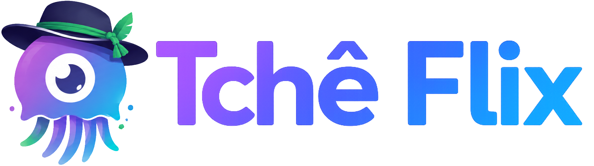

  <picture>
    <source media="(prefers-color-scheme: dark)" srcset="src/tcheflix/assets/tcheflix_banner_light.png">
    
  </picture>

A **personal** fork of [Jellium Desktop](https://github.com/andrewrabert/jellium-desktop), which is itself an unofficial [Jellyfin](https://jellyfin.org) client.

It exists so I can make whatever changes I want to the client for my own use. It's **not** affiliated with or endorsed by the Jellyfin project, nor by Jellium Desktop. The renaming/re-versioning/rebranding follow Jellyfin's [branding guidelines](https://jellyfin.org/docs/project/branding/) so that every surface makes clear this is a modified build — neither Jellyfin's nor Jellium Desktop's.

> [!IMPORTANT]
> Development and testing target **Windows** only, unlike upstream.
> You *can* use this fork, but know what you're getting: it's tailored to my preferences, multi-language support is a low priority, and things may break at any time (though it does stay maintained — I use it myself).

## What's different from upstream

- **On-player subtitle styling menu** — font, size, color, outline, position and bold, from inside the player.
- **Legible subtitle defaults** — 150% scale with a thin outline, like the old Qt client.
- **Auto-updater** — checks GitHub Releases on launch, downloads in the background, applies once you confirm.

## Permission

You're free to read, use, and modify my changes however you like — whether for your own personal use or to send them upstream as pull requests to [Jellium Desktop](https://github.com/andrewrabert/jellium-desktop). The upstream code is licensed under [GPL-2.0](LICENSE), and these modifications keep the same license.